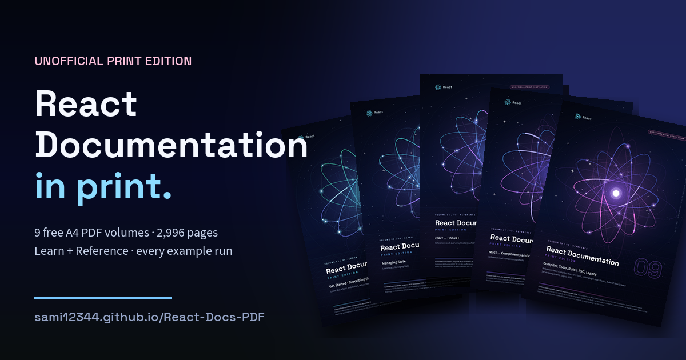

<h1 align="center">React Documentation — Print Edition</h1>

<b>The complete <a href="https://react.dev">react.dev</a> documentation (Learn + Reference) as 9 free, full-colour, printable A4 PDF books.</b> 
2,996 pages · 181 articles · 744 live examples run and captured · original figures · a master index 
<a href="https://sami12344.github.io/React-Docs-PDF/"><b>Website</b></a> · <a href="https://github.com/sami12344/React-Docs-PDF/releases/latest"><b>All downloads</b></a> · <a href="output/QUALITY-REPORT.md"><b>Quality report</b></a>

> **Unofficial.** Not produced, reviewed or endorsed by Meta or the React team. The documentation is © Meta Platforms, Inc. and the react.dev contributors, reproduced unchanged under [CC BY 4.0](https://creativecommons.org/licenses/by/4.0/). React and the React logo are trademarks of Meta Platforms, Inc. The person who compiled this edition is not the author of the documentation.

## Download

| Vol. | Part | Contents | Articles | Pages | Size | |
|---:|---|---|---:|---:|---:|---|
| **1** | Learn | Get Started · Describing the UI | 26 | 342 | 23.9 MB | [Download](https://github.com/sami12344/React-Docs-PDF/releases/download/v1.0.0/React-Print-Edition-Vol1.pdf) · [Read online](https://sami12344.github.io/React-Docs-PDF/pdf/React-Print-Edition-Vol1.pdf) |
| **2** | Learn | Adding Interactivity | 8 | 243 | 29.2 MB | [Download](https://github.com/sami12344/React-Docs-PDF/releases/download/v1.0.0/React-Print-Edition-Vol2.pdf) · [Read online](https://sami12344.github.io/React-Docs-PDF/pdf/React-Print-Edition-Vol2.pdf) |
| **3** | Learn | Managing State | 8 | 370 | 31.2 MB | [Download](https://github.com/sami12344/React-Docs-PDF/releases/download/v1.0.0/React-Print-Edition-Vol3.pdf) · [Read online](https://sami12344.github.io/React-Docs-PDF/pdf/React-Print-Edition-Vol3.pdf) |
| **4** | Learn | Escape Hatches | 9 | 435 | 37.4 MB | [Download](https://github.com/sami12344/React-Docs-PDF/releases/download/v1.0.0/React-Print-Edition-Vol4.pdf) · [Read online](https://sami12344.github.io/React-Docs-PDF/pdf/React-Print-Edition-Vol4.pdf) |
| **5** | Reference | react — Hooks I | 13 | 279 | 13.8 MB | [Download](https://github.com/sami12344/React-Docs-PDF/releases/download/v1.0.0/React-Print-Edition-Vol5.pdf) · [Read online](https://sami12344.github.io/React-Docs-PDF/pdf/React-Print-Edition-Vol5.pdf) |
| **6** | Reference | react — Hooks II | 7 | 301 | 26.9 MB | [Download](https://github.com/sami12344/React-Docs-PDF/releases/download/v1.0.0/React-Print-Edition-Vol6.pdf) · [Read online](https://sami12344.github.io/React-Docs-PDF/pdf/React-Print-Edition-Vol6.pdf) |
| **7** | Reference | react — Components and APIs | 20 | 377 | 27.6 MB | [Download](https://github.com/sami12344/React-Docs-PDF/releases/download/v1.0.0/React-Print-Edition-Vol7.pdf) · [Read online](https://sami12344.github.io/React-Docs-PDF/pdf/React-Print-Edition-Vol7.pdf) |
| **8** | Reference | react-dom | 42 | 341 | 16.6 MB | [Download](https://github.com/sami12344/React-Docs-PDF/releases/download/v1.0.0/React-Print-Edition-Vol8.pdf) · [Read online](https://sami12344.github.io/React-Docs-PDF/pdf/React-Print-Edition-Vol8.pdf) |
| **9** | Reference | Compiler, Tools, Rules, RSC, Legacy | 48 | 308 | 16.1 MB | [Download](https://github.com/sami12344/React-Docs-PDF/releases/download/v1.0.0/React-Print-Edition-Vol9.pdf) · [Read online](https://sami12344.github.io/React-Docs-PDF/pdf/React-Print-Edition-Vol9.pdf) |
| | | **Master index**: 181 articles, 1,460 topics, 106 APIs | | 31 | 1.7 MB | [Download](https://github.com/sami12344/React-Docs-PDF/releases/download/v1.0.0/React-Print-Edition-Master-Index.pdf) |
| | | **Complete edition**: all volumes and the master index in one file | 181 | 3,027 | 223.6 MB | [Download](https://github.com/sami12344/React-Docs-PDF/releases/download/v1.0.0/React-Print-Edition-Combined.pdf) |

Also in the [release](https://github.com/sami12344/React-Docs-PDF/releases/tag/v1.0.0): a 12-page sampler and the source package (scripts, page snapshot, original images, example run records).

Snapshot of react.dev taken on 2026-11-25 (site build `OD-iUkfVH2gz8tvhfiRWJ`, labelled react@19.3); repository [reactjs/react.dev](https://github.com/reactjs/react.dev) at `15653c0f9b95`. Examples run with React `19.3.0-canary-f1f7ed2a-20260904`, the version the site's sandboxes use.

## What is inside

- **Every word, in order.** The text of every Learn and Reference page, reproduced without summarising, rewriting or correcting. A check found all 1,065,344 source characters in the PDFs, in source order.
- **Nothing left folded.** Deep dives, challenges, hints, solutions and every file of every example (including the files the site never shows as tabs) are printed open, in source order.
- **Live examples, run for real.** All 744 sandboxes were rebuilt from their original files with the site's React version and run in headless Chrome. 1,144 print walkthroughs show BEFORE, ACTION and AFTER from real screenshots, with console output, dialogs and errors.
- **Original figures.** 93 illustrations and diagrams, the original light-mode files from react.dev, never redrawn; SHA-256 checksums in [the asset manifest](output/manifests/asset-manifest.csv).
- **Made for paper.** A4, mirrored margins for binding, 11.5 pt Source Sans 3, 10 pt Source Code Pro with syntax colour, line numbers that are not copied with the code, running heads.
- **Easy to navigate.** Contents, bookmarks, 5,048 internal links, page numbers after cross-references (even into other volumes), an index of original URLs per volume, and a master index with volume·page references.

## Accuracy, measured

| Check | Result |
|---|---|
| Source characters found in the PDFs in order | 1,065,344 / 1,065,344 |
| Code rows present | 47,755 / 47,755 |
| Examples printed once, at their source position | 744 / 744 |
| Original figures found | 93 / 93 |
| Broken internal links | 0 of 5,048 |
| Master index references checked against the volumes | 2,465 links, 0 out of range; all 181 article and 1,460 of 1,460 topic references found on their page |

Known limits (details in the [quality report](output/QUALITY-REPORT.md)): 7 examples have controls that could not be operated (inside a frame, or a drop-down with one option); typed input is always “Hello”; 13 tutorial screenshots are below 150 ppi in the original; hover effects, animation and sound cannot be printed.

## Printing

Print double-sided, flipping on the long edge; the margins are mirrored for binding. All 9 volumes come to 1,501 sheets of A4; the thickest volume has 218 sheets. Colour is recommended (syntax colours and callouts carry meaning). For US Letter, print with “fit to page”.

## How it is made

1. **Inventory** (`src/01_inventory.mjs`): reads the live Learn and Reference navigation of react.dev and stores every page with the compiled content the site embeds in it, cross-checked with the repository.
2. **Figures** (`src/02_assets.mjs`, `src/02b_gif.py`): downloads every original image (light-mode version) with SHA-256; GIFs are split into their original frames.
3. **Examples** (`src/03_sandboxes.mjs`, `src/04_run.mjs`): reassembles every sandbox as the site does (template, default CSS, hidden files, package.json), builds it with the same React version, lints it like the site, runs it in headless Chrome, operates its real controls and captures the results.
4. **Typesetting** (`src/05_book.mjs`, `src/lib/*`, `src/book.css`): print HTML rendered to PDF by Chrome (`06_render.mjs`), page numbers read back until stable (`07_pagemap.py`), running heads and bookmarks (`08_post.py`). Covers: `src/lib/cover.mjs` (an original vector design).
5. **Checks** (`09b_htmlorder.py`, `09_verify.py`, `overflow.mjs`, `11_livecheck.mjs`), **manifests and report** (`10_manifests.mjs`, `12_report.py`), **master index** (`17a`–`17c`), **packages** (`14_package.py`) and **website** (`16_site.mjs`, `16b_site_images.py`).

Rebuilding needs Node 20+, Python 3.10+ with PyMuPDF and Pillow, and Google Chrome; see [CHECKPOINT.md](CHECKPOINT.md) for the full sequence and the state of the build.

## Repository layout

| Path | Contents |
|---|---|
| `src/` | The build scripts |
| `fonts/` | Source Sans 3, Source Code Pro, Space Grotesk, Noto fallbacks (SIL OFL 1.1) |
| `output/QUALITY-REPORT.md` | Coverage, text, code, figure, interaction and layout checks |
| `output/manifests/` | Source inventory, asset manifest (SHA-256), interaction manifest |
| `output/licences/` | CC BY 4.0 text, font licences, attribution notice |
| `site/` | The download website (deployed to GitHub Pages) |

The PDFs are attached to the [release](https://github.com/sami12344/React-Docs-PDF/releases/tag/v1.0.0), not stored in the repository.

## Licence

- **Documentation** (text, code examples, figures in the PDFs): © Meta Platforms, Inc. and affiliates and the react.dev contributors, [CC BY 4.0](https://creativecommons.org/licenses/by/4.0/). Changes: re-typeset for print, interface removed, collapsed content expanded, example results and walkthroughs, navigation aids and the master index added.
- **Build scripts** (`src/`) and the website: MIT, see [LICENSE](LICENSE).
- **Fonts**: SIL Open Font License 1.1.
- **Trademarks**: React and the React logo are trademarks of Meta Platforms, Inc.; no trademark rights are granted. The cover artwork is an original design for this edition.
